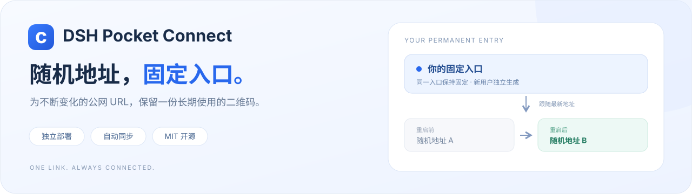
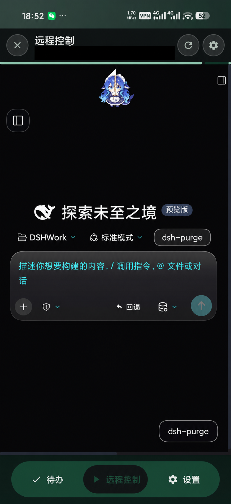
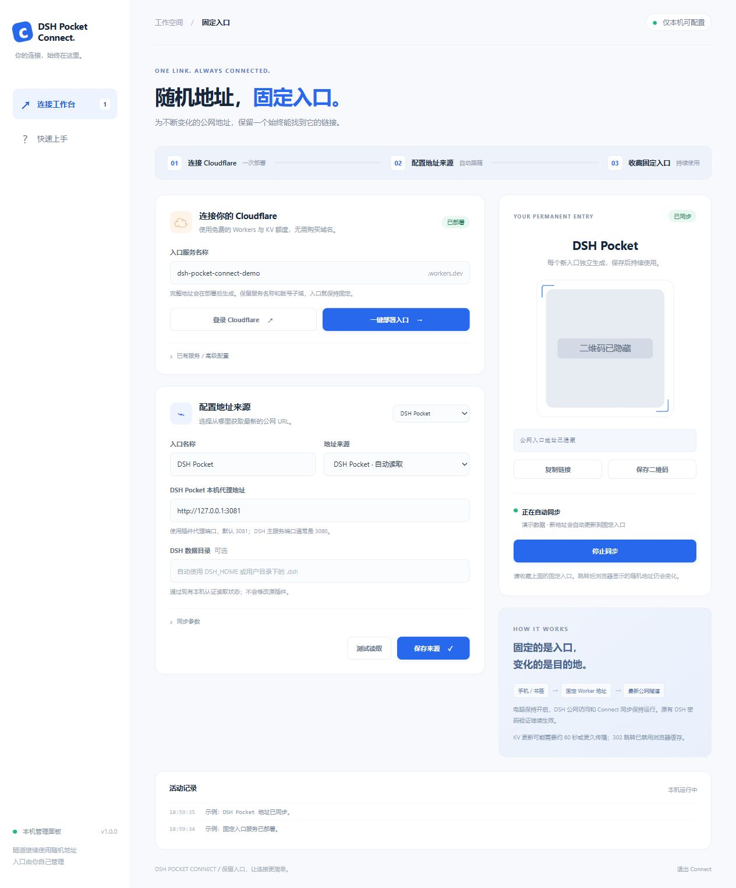
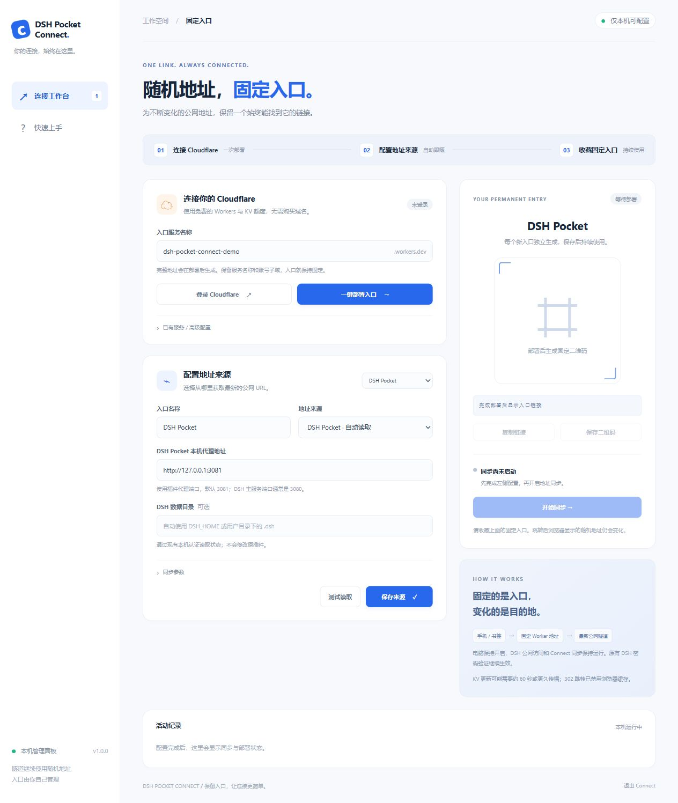
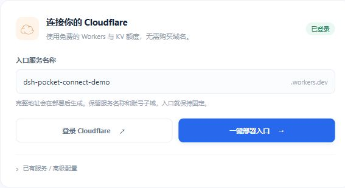
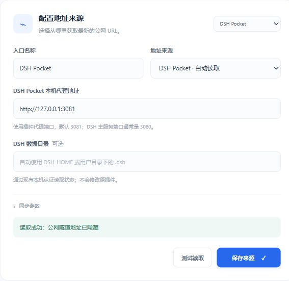
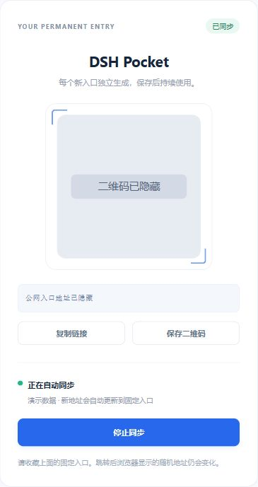
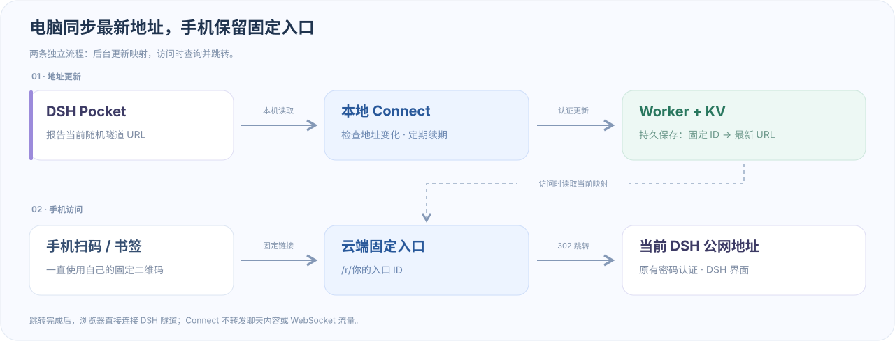

# DSH Pocket Connect

**为 DSH Pocket 提供一个长期不变的手机访问入口。** 当公网隧道重启、随机 URL 改变时，Connect 自动更新跳转目标，让你继续使用原来的二维码或书签。



## 解决什么问题

DSH Pocket 的默认公网隧道使用随机地址。关闭后重新开启，地址可能从 A 变成 B，之前保存的二维码和书签就无法继续指向当前服务。出门后再发现地址变化，通常还需要回到电脑查看新地址。

Connect 在前面增加一层由你自己管理的固定入口：**手机入口不变，电脑在后台更新最新地址。**

| 使用时遇到的问题 | Connect 带来的好处 |
|---|---|
| 隧道重启后随机 URL 改变，旧二维码失效 | 保留同一份固定二维码或书签，自动跳到最新地址 |
| 每次变化都要重新把链接发到手机 | 电脑定期检查并更新，减少重复复制与扫码 |
| 不想为了固定入口购买域名 | 使用自己账号下的 `workers.dev` 平台子域和 Cloudflare 免费额度 |
| 多个服务需要分别配置 | 支持多个独立入口，以及 DSH Pocket、JSON、日志、手动 URL 等来源 |
| 担心使用别人托管的中转服务 | Worker、KV 和更新密钥由你自己的 Cloudflare 账号管理 |

本项目是独立工具，**不修改 DSH Pocket 插件**。Windows 可双击快速配置，macOS / Linux 可通过 Node.js 运行。跳转后，聊天和 WebSocket 流量直接通过原来的 DSH 隧道，访问密码继续由 DSH Pocket 校验。

**使用前提：**电脑上的 DSH、DSH Pocket 公网隧道和 Connect 同步需要保持运行，手机网络需要能够访问固定入口及当前隧道。免费额度和 KV 更新延迟见后文说明。

## 手机连接成功的效果

手机通过固定入口跳转、完成原有认证后，可以进入 DSH 主界面。下面基于用户提供的连接成功截图制作了地址栏遮盖版本；DSH 的界面样式会随个人配置而不同。



## 界面预览

<details>
<summary>查看配置完成后的完整面板</summary>



</details>

> 配置教程使用虚构演示数据，截图中的二维码和公网地址均已遮盖。本机示例端口予以保留，方便填写。实际使用时，每位用户会生成自己的固定链接和二维码。

## 快速开始

运行环境：**Node.js 22 或更新版本**、你自己的 Cloudflare 账号，以及能访问 Cloudflare 和目标隧道的网络。项目文件夹建议命名为 `DSH-Pocket-Connect`。

### 第 1 步：启动配置面板

下载并解压项目，进入 `DSH-Pocket-Connect` 文件夹，双击 **`快速开始.vbs`**（或 `quick-start.vbs`），不显示终端窗口。首次运行会在后台安装依赖，再自动打开下面的本机面板，请稍等。也可使用 `快速开始.cmd` / `quick-start.cmd`，启动后终端会自动关闭。右侧显示“等待部署”属于正常的初始状态。

macOS / Linux 在项目目录运行 `sh start.sh`。



### 第 2 步：登录 Cloudflare 并部署入口

1. 点击左侧 **登录 Cloudflare**，在新打开的 Cloudflare 页面登录你自己的账号，完成授权后回到本机面板。无需向任何人发送密码、API Token 或验证码。
2. 面板显示 **已登录** 后，保留自动生成的“入口服务名称”，点击 **一键部署入口**。图中的服务名仅是示例，不需要照抄。
3. 等待部署完成，状态会变为 **已部署**，右侧会出现属于你的固定链接和二维码。工具会自动创建 KV、部署 Worker 并配置随机更新密钥。



### 第 3 步：配置并测试地址来源

1. 启动 DSH，在 **DSH Pocket** 中开启公网访问。
2. 回到本机面板，在“配置地址来源”中选择 **DSH Pocket · 自动读取**，填写入口名称。
3. 本机代理地址默认填写 **`http://127.0.0.1:3081`**。如果插件使用了其他端口，以 DSH Pocket 实际显示的代理端口为准；数据目录通常留空即可。
4. 点击 **测试读取**。看到“读取成功”及当前隧道 URL 后，点击 **保存来源**。截图中的公网 URL 已隐藏，实际面板会显示读取到的地址。



### 第 4 步：开始同步，保存自己的二维码

1. 在右侧点击 **开始同步**。同步成功后会显示 **已同步 / 正在自动同步**，按钮变为“停止同步”，如下图。
2. 点击 **保存二维码**，将自己生成的二维码保存到手机；也可以点击 **复制链接**，将固定入口添加到手机书签。
3. 手机打开该入口后，输入 DSH Pocket 的公网访问密码。以后隧道 URL 改变，继续使用这份固定入口即可。



> 教程图片中的二维码和公网地址已遮盖。请使用你自己面板上生成的链接与二维码。电脑上的 DSH、公网隧道和 Connect 同步需要保持运行。

“快速开始”先打开的是**本机配置面板**；点击面板中的“登录 Cloudflare”后，才会打开 Cloudflare 授权页。如果浏览器没有自动显示，启动窗口会保留完整的“配置面板”链接，复制该链接到浏览器打开即可。

“保存服务配置”会在按钮旁直接显示保存结果。保存自动同步选项时，正在运行的同步会继续运行；修改入口服务地址或更新密钥时，工具会重新连接并继续同步。

首次使用 Workers 时，如 Cloudflare 提示尚未注册 `workers.dev` 子域，请在 [Workers & Pages 面板](https://dash.cloudflare.com/?to=/:account/workers-and-pages) 先设置免费的账号子域，再回来点击部署。这里使用平台子域，不需要购买自己的域名。

DSH 默认会在重新开启公网访问时换一个随机密码。若你希望出门后不再查看新密码，可在 **DSH Pocket → 手机访问 → 公网密码 → 自定义** 中设置自己的固定密码。Connect 只同步隧道 URL，DSH 的认证仍由原插件负责。

> 每位使用者都需要登录自己的 Cloudflare 账号并部署。仓库没有预置作者的 Worker、账号、更新密钥或可供所有人共用的二维码。

## 每个人的二维码是否不同

**不同安装独立生成；同一入口持续保持固定。** 首次运行会自动生成：

- Worker 服务名：`dsh-pocket-connect-` 加随机后缀。
- 入口 ID：18 字节安全随机数（144 位），用于 `/r/<入口ID>`。
- 更新密钥：32 字节安全随机数（256 位），只保存在私人运行配置中。

每个人部署到自己的 `workers.dev` 子域。二维码由 **自己的 Worker URL + 自己的入口 ID** 生成；新增入口也会获得新的随机 ID。DSH 随机 URL 改变时，二维码保持原样。

首次打开面板会自动初始化；也可以先运行 `npm run init`。重复初始化、重启或保存来源不会重置已有入口 ID。`connect.example.json` 只说明字段结构，其中 ID 和密钥故意留空，不能直接作为运行配置。请用初始化命令生成，而不要复制别人的 `data/config.json`。

如果把自己的 `data/` 一起复制给别人，对方会继承你的入口和凭据；这属于迁移，不是独立安装。分享请使用文末的源码打包方式。

## 工作原理



电脑上的 Connect 负责更新地址；手机访问时，云端入口查询当前映射并返回 302。跳转后的 DSH 页面、聊天和 WebSocket 仍由原隧道承载。

## 功能

- 一个 Worker 管理多个独立入口，每个入口有独立、随机生成的固定 ID。
- 本机图形化配置面板：登录、部署、来源测试、二维码下载、同步状态与活动记录。
- 地址来源：DSH Pocket、通用 JSON 接口、日志 / 文本文件、手动 URL。
- 独立同步进程：地址变化才更新；持续在线时低频续期；瞬时故障有宽限期。
- 302 响应设置 `Cache-Control: no-store`，防止浏览器一直缓存旧跳转。
- 更新接口使用独立密钥认证；固定二维码不包含更新密钥或 DSH 密码。
- 正常停止时标记离线；失联超时显示等待页面，并每 15 秒重试。

## 后续每天怎么用

1. 电脑保持开机，打开 DSH，并按原方式开启公网访问。
2. 打开 Connect 面板，点击 **开始同步**。勾选“下次打开本机面板时，自动开始同步”可省去这个点击。
3. 手机打开你保存的 **固定入口**。实际跳转后的地址仍是每次生成的新 URL。

Windows 双击“快速开始”默认在后台运行，不需要保留终端窗口，关闭浏览器页面也不会停止同步。再次双击会打开同一个配置面板；需要停止时，点击面板底部的“退出 Connect”。

也可以手动启动后台进程（不打开浏览器）：

```powershell
powershell -NoProfile -ExecutionPolicy Bypass -File .\scripts\start-background.ps1
```

如果使用 `node bin/connect.mjs ui` 或 macOS / Linux 的 `start.sh` 在前台运行，仍需保留对应终端。可选的 Windows 当前用户登录自启：

```powershell
# 先在面板启用“下次打开本机面板时，自动开始同步”
powershell -NoProfile -ExecutionPolicy Bypass -File .\scripts\install-startup.ps1

# 取消登录自启
powershell -NoProfile -ExecutionPolicy Bypass -File .\scripts\remove-startup.ps1
```

## 其他隧道也可以使用

| 场景 | 来源类型 | 填写示例 |
|---|---|---|
| DSH Pocket | DSH Pocket | 本机代理 `http://127.0.0.1:3081` |
| ngrok 等提供状态接口的程序 | JSON 接口 | `http://127.0.0.1:4040/api/tunnels`，字段 `tunnels.0.public_url` |
| cloudflared 的输出日志 | 日志文件 | 日志完整路径，默认提取最后一个 `https://xxx.trycloudflare.com` |
| 自己的启动脚本 / 其他工具 | 手动 URL 或 CLI push | 获得新地址后提交给 Connect |

手动 URL 需要你在地址变化时重新提交。日志来源只表示“日志里的最新地址”；DSH / JSON 来源以原程序报告的状态为准。**“已同步”表示地址已提交，不代表已验证公网可达性。** Connect 不会自行开启 DSH 的公网访问，也不会管理或修改你原来的隧道程序。

详细字段见 [地址来源](docs/sources.md)。

## 命令行

Windows 在项目目录使用 `connect.cmd`；其他平台使用 `node bin/connect.mjs`。

```powershell
.\connect.cmd init             # 为当前安装生成独立配置；保留已有配置
.\connect.cmd setup            # 终端配置向导
.\connect.cmd status           # 查看入口 ID、配置摘要和固定链接，不输出更新密钥
.\connect.cmd test             # 测试第一个入口的来源
.\connect.cmd sync             # 持续同步，Ctrl+C 停止
.\connect.cmd push https://new-tunnel.trycloudflare.com
.\connect.cmd offline          # 标记离线
.\connect.cmd qr               # 导出固定 PNG 二维码到 data/qr/
```

多个入口可添加 `--id <入口ID>`。`push` 是一次性更新，默认持续有效，适合接入其他程序的“隧道已就绪”回调；不要同时对同一个入口运行自动同步和手动推送，否则下一次同步可能覆盖手动地址。

macOS / Linux：`sh start.sh` 或 `npm ci && npm start`。

## 免费额度和更新延迟

- Workers Free 当前包含每天 100,000 次请求；KV Free 当前包含每天 100,000 次读取、1,000 次写入。个人用途一般可以控制在免费额度内，**不是无限免费**。以 [Cloudflare 官方价格](https://developers.cloudflare.com/workers/platform/pricing/) 为准。
- 默认每 10 秒检查本机状态，但**不会每 10 秒写 KV**。地址不变时每 15 分钟续期一次，持续在线时每个入口约 96 次续期写入 / 天，外加地址变化和离线更新。
- KV 是最终一致的存储，不同地区可能需要约 60 秒或更久才能读到更新；首次创建也可能有延迟。禁用 HTTP 缓存不能消除 KV 自身的传播延迟。见 [KV 一致性说明](https://developers.cloudflare.com/kv/concepts/how-kv-works/)。
- 自动来源的地址有效期默认 30 分钟。正常停止会主动标记离线；断电或进程被强制结束时，旧地址最多保留到有效期结束，另加 KV 传播延迟。

## 配置与分享

私人运行配置在 `data/config.json`。Cloudflare 登录资料、更新密钥、日志和运行状态也都放在 `data/`，已被 `.gitignore` 排除。

- **自己的备份**：保管 `data/config.json`，尤其是入口 ID。重建该文件会生成新的入口 ID，因此应备份已使用的配置。
- **分享给别人 / 上传 GitHub**：只分享源码；不要分享自己的 `data/`。运行 `npm run pack:source` 可生成排除私人运行资料的源码 ZIP。
- 固定入口依赖 Worker 名称、账号 `workers.dev` 子域和入口 ID。保留这三项，更新代码或重开隧道不会改变入口。
- 已有服务可在“已有服务 / 高级配置”中填写 Worker 地址和它对应的更新密钥。
- 不支持多人权限隔离：同一个 Worker 的更新密钥可以管理该 Worker 下的所有入口；独立用户应各自部署。

### 发布到 GitHub

```sh
npm run check
npm test
npm run pack:source
```

发布包为 `dist/DSH-Pocket-Connect-source.zip`，解压后的顶层目录为 `DSH-Pocket-Connect/`。包中只包含源码、锁文件、文档和测试，不包含依赖、私人配置、OAuth、日志或已经生成的二维码。其他人下载后双击快速开始即可安装依赖并配置自己的服务。

建议先解压这个干净的源码包，再将其内容上传到 GitHub 仓库 `DSH-Pocket-Connect`。通过 Git 提交时先查看 `git status` 和暂存区；不要把运行过的整套桌面文件直接拖进 GitHub 网页，因为网页上传不受本地 `.gitignore` 保护。

安全说明见 [SECURITY.md](SECURITY.md)，开发说明见 [CONTRIBUTING.md](CONTRIBUTING.md)。

## 开发与验证

```powershell
npm ci
npm run check
npm test
npm run worker:build            # 仅本地打包，不发布
```

本地 Worker 调试：

```powershell
# 测试密钥仅用于本地调试；正式部署自动生成自己的随机密钥
npx wrangler dev --local --config cloudflare/wrangler.jsonc --var UPDATE_TOKEN:local-only-test-secret-0123456789abcdef
```

架构、接口和配置说明见 [架构说明](docs/architecture.md)，常见问题见 [排障说明](docs/troubleshooting.md)。

## 项目结构

```text
bin/connect.mjs          命令行入口和快速配置向导
cloudflare/worker.mjs    固定入口 / 302 跳转 / 认证更新接口
lib/                    配置、来源、同步、部署和本机面板服务
ui/                     本机配置面板（无外部 CDN）
scripts/                后台运行、登录自启、语法检查和源码打包
test/                   Worker / 来源 / 同步 / 本机接口测试
docs/                   使用与接入文档
data/                   私人运行资料（不随源码分享）
```

DSH Pocket Connect 使用 MIT 许可。DSH Pocket、Cloudflare、ngrok 为各自项目或公司的名称；本项目是独立客户端工具，不包含或修改 DSH Pocket 的代码。
