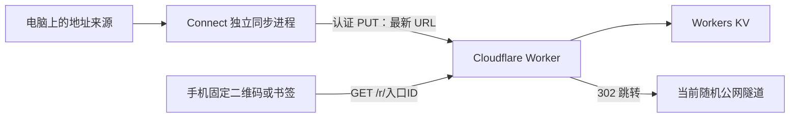

# 架构和接口



入口服务负责寻找目的地，不代理 DSH 的聊天内容、终端流量或 WebSocket。跳转后，浏览器直接连接当前隧道，原应用负责自己的认证。

## 公网接口

### `GET /health`

返回服务名称、版本和是否已配置 KV / 更新密钥。没有入口枚举接口。

### `GET /r/:id`

ID 为 16–80 位 URL 安全字符，默认由 18 字节安全随机数生成。

- 当前记录在线且租期有效：302，`Location` 为记录里的目标 URL。
- 未上线、过期或标记离线：503 等待页，每 15 秒刷新。
- 不把固定入口的查询参数附加到目标上。
- 每个响应都使用 `Cache-Control: no-store` 和 `Referrer-Policy: no-referrer`。

### `PUT /api/links/:id`

请求头：

```text
Authorization: Bearer <UPDATE_TOKEN>
Content-Type: application/json
```

请求体：

```json
{
  "url": "https://new-random.trycloudflare.com/",
  "label": "DSH Pocket",
  "leaseSeconds": 1800
}
```

`url: null` 标记离线。`leaseSeconds: 0` 表示持续有效；其他值应在 60–86400 秒之间。最多 8 KB 请求体，拒绝非 HTTPS URL、URL 用户名和密码。默认不限制 HTTPS 目标域名，以兼容不同隧道。

Worker 可选变量：

- `ALLOWED_HOSTS`：逗号分隔的域名白名单，如 `*.trycloudflare.com,custom.example.com`。
- `ALLOW_HTTP=true`：允许 HTTP 目标，仅在明确需要时自行配置。默认关闭。

### `GET /api/links/:id`

相同密钥认证，返回记录。KV 读取有传播延迟，不应把这个接口当成全局即时一致性的确认。

## 本机服务

本机面板默认只监听 `127.0.0.1:4178`；端口被占用时尝试后续 9 个端口。API 使用每次启动随机生成的本机会话密钥，并校验 Host / Origin；配置密钥不返回给页面。

`data/instance.json` 用于重复打开同一个面板。配置、OAuth 资料和日志都在 `data/`，不会进入源码 ZIP。

## 同步策略

读到新地址后，立即认证提交更新。连续读取到相同地址时不重复写入，直到续期周期到达。来源短暂失败进入宽限状态；持续失败才标记离线。上传失败不会记为成功，下次检查会重试。恢复在线后重新发布地址。

正常退出尽力提交离线标记；断电或强制结束依赖租期过期。KV 最终一致性意味着“已提交”不等同于所有地区立即读到新值。

本机面板和命令行 `sync` 应只运行其中一种，避免两个同步进程对同一个入口重复写入。快速启动会复用同一个本机面板进程。

## 云端部署

使用锁定版本的 Wrangler，通过浏览器 OAuth 登录。部署先创建 KV，立即保存 ID 供重试复用；随后使用 `deploy --secrets-file` 一并发布 Worker 和随机更新密钥。临时密钥文件在部署结束后移除。

不会改变 Cloudflare 套餐、购买域名、打开计费功能或删除已有 Worker。重新部署会更新配置中**同名的 Worker**，请为 Connect 保留独立的服务名称。
